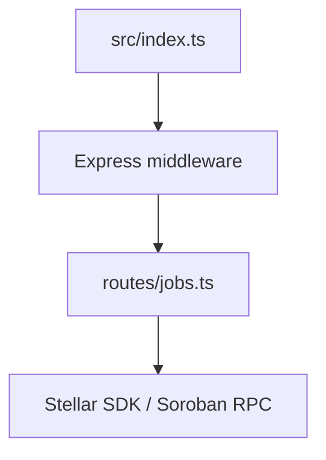
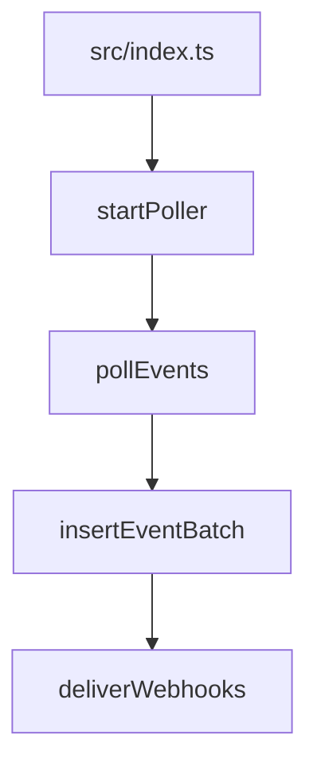

# Architecture: Live Paths vs Unwired Libraries

This backend currently has two runtime paths started from [`src/index.ts`](../src/index.ts):

- **Request path**: incoming HTTP request handling and Soroban RPC calls.
- **Indexer path**: background polling, event persistence, and webhook delivery.

Anything not statically reachable from [`src/index.ts`](../src/index.ts) is treated as **unwired library code** in this document.

## Runtime paths





## How to tell if a module is live or unwired

Run the static import walk:

```bash
node scripts/reachability.mjs
```

The script starts from [`src/index.ts`](../src/index.ts), follows relative imports, and prints each `src/**/*.ts` module as `live` or `unwired`. CI runs `node scripts/reachability.mjs --check` and fails when the committed table below drifts from the source graph.

## Source module reachability

Legend:
- **live**: reachable from [`src/index.ts`](../src/index.ts) by static imports.
- **unwired**: not currently reachable in runtime; tracked in [Goldii-locks/escrow-backend#718](https://github.com/Goldii-locks/escrow-backend/issues/718).

<!-- reachability:start -->
| Module | Status | Tracking issue |
|---|---|---|
| `src/app.ts` | live | — |
| `src/config.ts` | live | — |
| `src/index.ts` | live | — |
| `src/indexer/db.ts` | live | — |
| `src/indexer/event_type_filter.ts` | live | — |
| `src/indexer/failover-recovery.ts` | live | — |
| `src/indexer/failure-monitor.ts` | live | — |
| `src/indexer/indexer_metrics_collector.ts` | live | — |
| `src/indexer/indexer_runner.ts` | live | — |
| `src/indexer/job-state-cache.ts` | live | — |
| `src/indexer/ledger-range-tracker.ts` | live | — |
| `src/indexer/poller.ts` | live | — |
| `src/indexer/reconciliation.ts` | live | — |
| `src/indexer/rpc-poller-client.ts` | live | — |
| `src/indexer/sqlite_schema_manager.ts` | live | — |
| `src/indexer/sqlite_vacuum_cleaner.ts` | live | — |
| `src/indexer/status.ts` | live | — |
| `src/indexer/webhook-delivery.ts` | live | — |
| `src/middleware/adminAuth.ts` | live | — |
| `src/middleware/api-version.ts` | live | — |
| `src/middleware/apiKeyAuth.ts` | live | — |
| `src/middleware/create-job-draft-validation.ts` | live | — |
| `src/middleware/error-handler.ts` | live | — |
| `src/middleware/global-cors.ts` | live | — |
| `src/middleware/job-contract-rate-limit.ts` | live | — |
| `src/middleware/job-contract-security.ts` | live | — |
| `src/middleware/rateLimiter.ts` | live | — |
| `src/middleware/refund-ratio-rate-limit.ts` | unwired | [#718](https://github.com/Goldii-locks/escrow-backend/issues/718) |
| `src/middleware/request-id.ts` | live | — |
| `src/middleware/tax-deduction-rate-limit.ts` | unwired | [#718](https://github.com/Goldii-locks/escrow-backend/issues/718) |
| `src/middleware/validate.ts` | live | — |
| `src/readiness.ts` | live | — |
| `src/routes/admin.ts` | live | — |
| `src/routes/jobs.ts` | live | — |
| `src/routes/jobs/build-tx.ts` | live | — |
| `src/routes/jobs/by-wallet.ts` | live | — |
| `src/routes/jobs/caches.ts` | live | — |
| `src/routes/jobs/claim-auto-release.ts` | live | — |
| `src/routes/jobs/create-job-draft.ts` | live | — |
| `src/routes/jobs/errors.ts` | live | — |
| `src/routes/jobs/get-job.ts` | live | — |
| `src/routes/jobs/history-csv.ts` | live | — |
| `src/routes/jobs/history.ts` | live | — |
| `src/routes/jobs/partial-release.ts` | live | — |
| `src/routes/jobs/shared.ts` | live | — |
| `src/routes/jobs/sponsor.ts` | live | — |
| `src/routes/jobs/submit.ts` | live | — |
| `src/routes/jobs/time-remaining.ts` | live | — |
| `src/routes/jobs/whitelist.ts` | live | — |
| `src/routes/stats.ts` | live | — |
| `src/routes/tokens.ts` | live | — |
| `src/routes/webhooks.ts` | live | — |
| `src/routes/whitelist.test.ts` | unwired | [#718](https://github.com/Goldii-locks/escrow-backend/issues/718) |
| `src/schemas/jobs.ts` | live | — |
| `src/shutdown.ts` | live | — |
| `src/types/express.d.ts` | unwired | [#718](https://github.com/Goldii-locks/escrow-backend/issues/718) |
| `src/utils/api-keys.ts` | live | — |
| `src/utils/api-response.ts` | live | — |
| `src/utils/audit_ledger_sum_checker.ts` | live | — |
| `src/utils/conversion_rate_math.ts` | unwired | [#718](https://github.com/Goldii-locks/escrow-backend/issues/718) |
| `src/utils/csv-serializer.ts` | live | — |
| `src/utils/db-precision.ts` | live | — |
| `src/utils/digit-limit-validator.ts` | live | — |
| `src/utils/fee-deduction-calculator.ts` | live | — |
| `src/utils/fee-helper.ts` | live | — |
| `src/utils/financial_report_math.ts` | unwired | [#718](https://github.com/Goldii-locks/escrow-backend/issues/718) |
| `src/utils/format-error.ts` | live | — |
| `src/utils/interest_yield_estimator.ts` | unwired | [#718](https://github.com/Goldii-locks/escrow-backend/issues/718) |
| `src/utils/log-redaction.ts` | live | — |
| `src/utils/logger.ts` | live | — |
| `src/utils/partial_payment_allocator.ts` | unwired | [#718](https://github.com/Goldii-locks/escrow-backend/issues/718) |
| `src/utils/partial-payment-allocator.ts` | live | — |
| `src/utils/push_notification_service.ts` | unwired | [#718](https://github.com/Goldii-locks/escrow-backend/issues/718) |
| `src/utils/refund_ratio_helper.ts` | unwired | [#718](https://github.com/Goldii-locks/escrow-backend/issues/718) |
| `src/utils/rounding.ts` | live | — |
| `src/utils/rpc-allow-http.ts` | live | — |
| `src/utils/safe-json.ts` | live | — |
| `src/utils/soroban-call.ts` | live | — |
| `src/utils/stablecoin_cents_multiplier.ts` | unwired | [#718](https://github.com/Goldii-locks/escrow-backend/issues/718) |
| `src/utils/stellar.ts` | live | — |
| `src/utils/tax_deduction_estimator.ts` | unwired | [#718](https://github.com/Goldii-locks/escrow-backend/issues/718) |
| `src/utils/token_decimals_converter.ts` | live | — |
| `src/utils/token-metadata.ts` | live | — |
| `src/utils/trust-proxy.ts` | live | — |
| `src/utils/webhook_dispatcher.ts` | live | — |
| `src/utils/webhook_signature_verifier.ts` | unwired | [#718](https://github.com/Goldii-locks/escrow-backend/issues/718) |
| `src/utils/webhook-url-guard.ts` | live | — |
<!-- reachability:end -->
